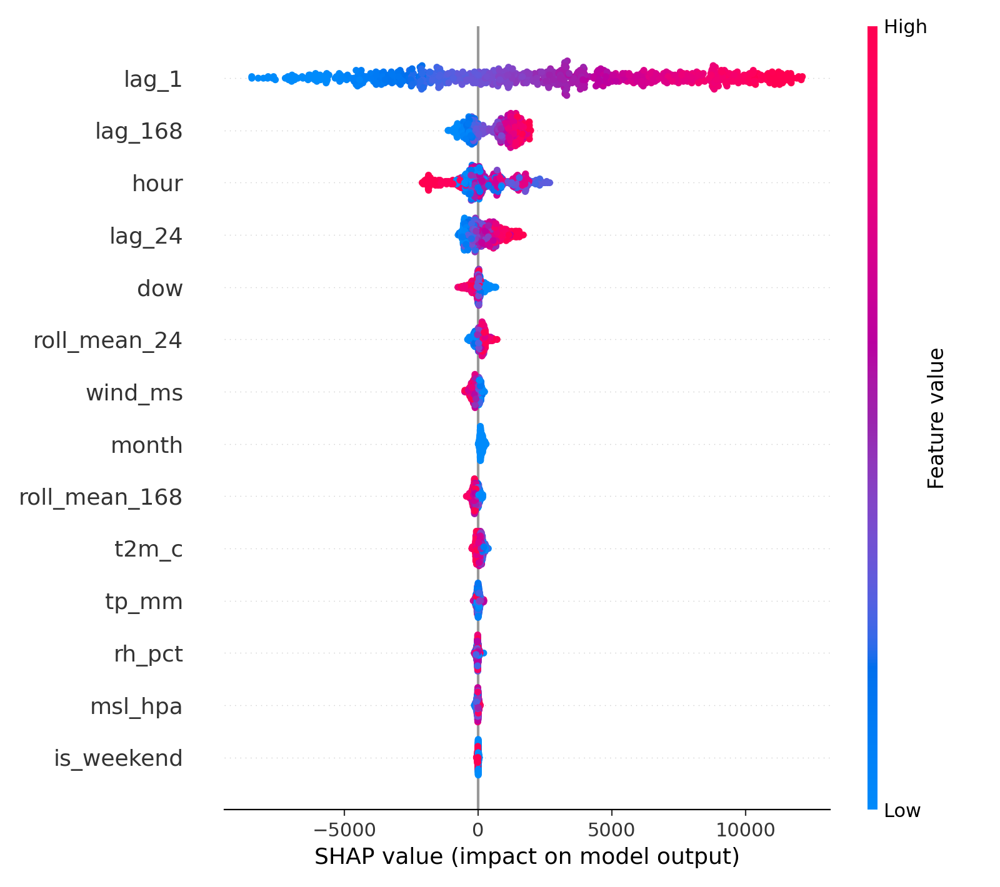
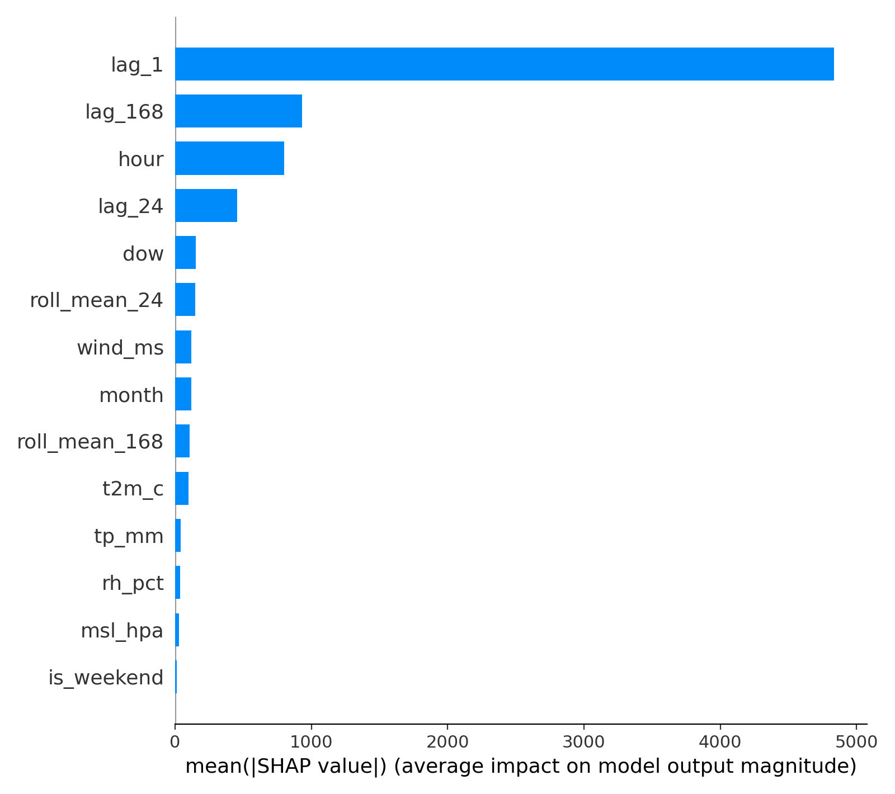
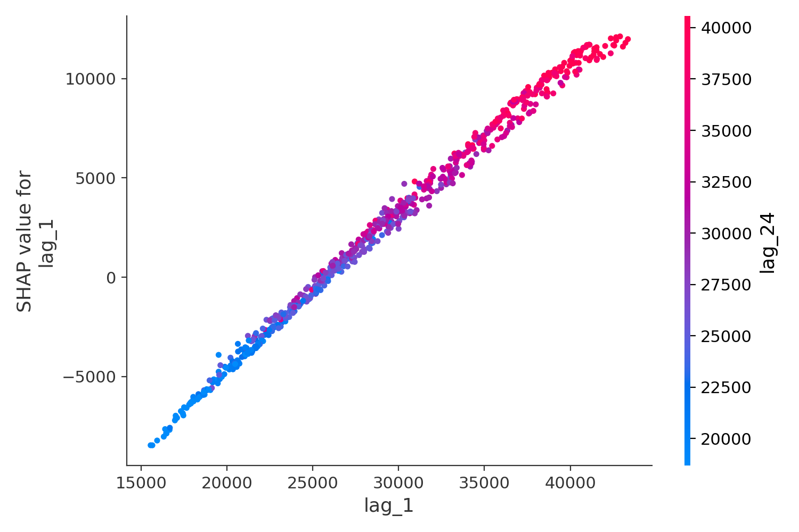
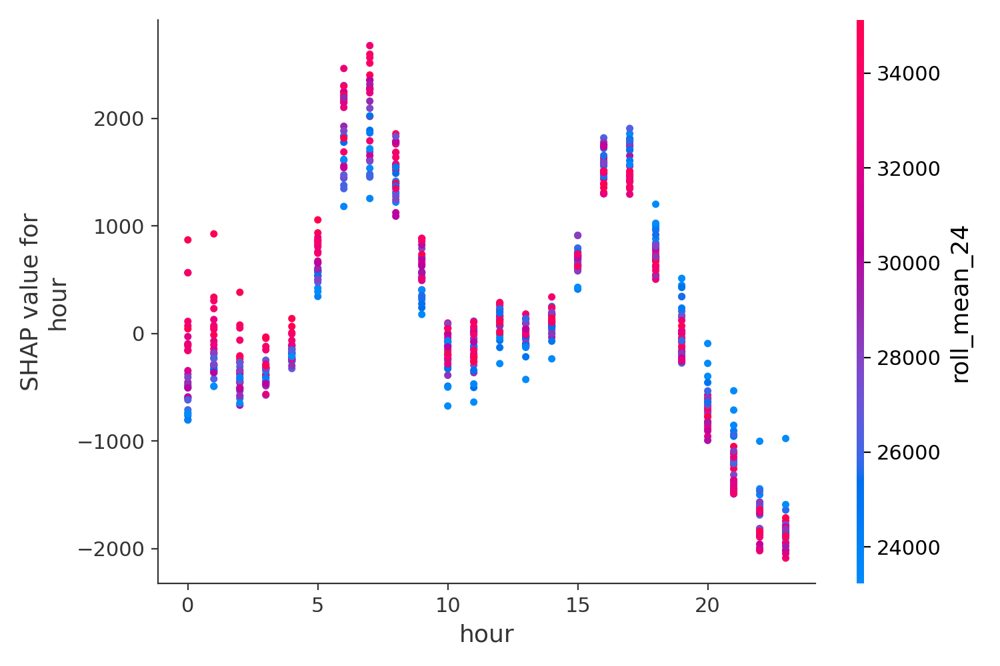
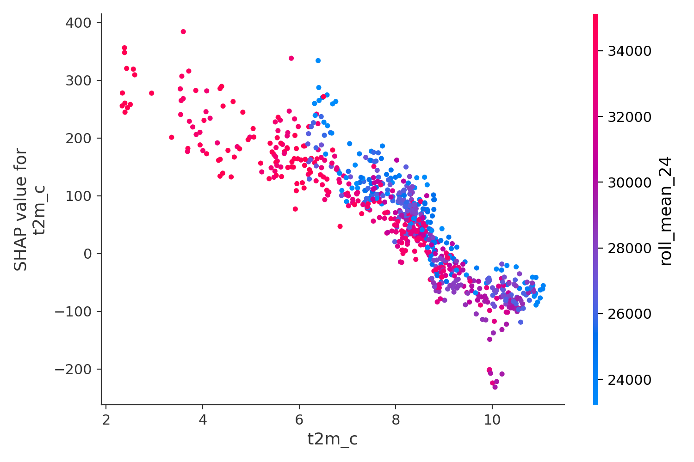

***
# ChronosCast
***
**UK Electricity Demand Forecasting + ERA5 Weather Feature Store + Leakage-Safe Backtesting**

---

ChronosCast is a forecasting system that predicts UK electricity demand using historical grid demand and weather drivers from ERA5. This project is built similarly to a real forecasting pipeline using the standart data lake architecture (bronze, silver, gold), a proper feature store, leakage-safe walk-forward evaluation, baseline comparison, and explainability outputs.

---

## The ChronosCast Pipeline
ChronosCast produces a reproducible pipeline that builds:

- **Silver Demand Table** (hourly, cleaned, UTC)  
- **Silver Weather Table** (ERA5 spatial mean over UK region, hourly)  
- **Gold Feature Store Table** (lags, rolling stats, calendar and weather features)  
- **Walk-forward backtesting framework** (12 folds)  
- **Model comparison** (baseline vs LightGBM)  
- **Explainability + error breakdown** (hourly error profile, feature importance, and SHAP)

---

## Results

### Baseline vs LightGBM (Walk-forward backtest, 12 folds)
| Model | Mean MAE (MW) | Mean MAPE (%) |
|------:|--------------:|--------------:|
| Weekly Naive (same hour last week) | **1803 MW** | **7.04%** |
| LightGBM Feature Store Model | **596 MW** | **2.21%** |

**Average improvement vs baseline**
- **MAE gain:** **1207 MW**
- **MAPE gain:** **4.83 percentage points**

---

## Why this is an authentic forecasting build
This project follows the conventional patterns used in production analytics teams:

- **Separation of bronze/silver/gold layers**
- **Leakage-safe feature engineering**
- **Walk-forward validation (no erroneous random splits)**
- **Strong seasonal baseline**
- **Model explainability (drivers of peaks and importance plots)**

---

## Data sources

### UK Demand (National Grid / NESO)
Demand was sourced from published National Grid/NESO historic demand data exports.  
Raw demand files are treated as **bronze** inputs.

### Weather (ERA5 via CDS API)
Weather features are built from ERA5 reanalysis data:
- 2m temperature (`t2m`)
- 10m winds (`u10`, `v10`) -> wind speed magnitude
- mean sea level pressure (`msl`)
- total precipitation (`tp`)
- dewpoint (`d2m`) -> relative humidity (derived)

Hourly weather was spatially aggregated using a mean over the UK bounding region.

---

## Repository layout

***

```text
├── README.md
├── data_lake
│   ├── bronze
│   │   ├── era5
│   │   └── neso
│   ├── gold
│   └── silver
├── pyproject.toml
├── reports
│   └── figures
└── scripts
    ├── backtest.py
    ├── backtest_split.py
    ├── backtest_walkforward.py
    ├── build_gold_feature_store.py
    ├── build_gold_features.py
    ├── build_silver.py
    ├── build_silver_weather.py
    ├── check_join_jan.py
    ├── era5_download_uk_2023.py
    ├── find_null_weather.py
    ├── find_time_gap.py
    ├── full_lgbm.py
    ├── full_silver_builder.py
    ├── lgbm_error_breakdown.py
    ├── lgbm_importance.py
    ├── plot_week.py
    ├── shap_dependence_lgbm.py
    ├── shap_summary_lgbm.py
    └── train_lgbm_test.py

```

***

---

## Setput

### Create Environment

```bash
conda create -n chronoscast python=3.11 -y
conda activate chronoscast
python -m pip install -e ".[dev]"
```
***

### IMPORTANT: macOS note

**On macOS, LightGBM may fail to import due to missing openMP:**

```bash
brew install libomp
```

---

## Pipeline Walkthrough

### Silver - Demand

**Produces:** data_lake/silver/demand_uk_hourly.parquet

**Key steps:**

- parse settlement date + settlement period -> timestamp
- enforce UTC
- aggregate to hourly (mean)
- validate continuity (DST gap handled)


***


### Silver - Weather

**Produces:** data_lake/silver/weather_uk_hourly.parquet

**Key steps:**

- download ERA5 monthly zips
- extract and merge “instant” + “accum” files
- spatial mean aggregation

**derive:**

- temperature in °C
- wind magnitude (m/s)
- relative humidity (%)
- pressure (hPa)
- precipitation (mm)

***

### Gold - Feature Store

**Produces:** data_lake/gold/feature_store_2023.parquet

**Features included:**

- calendar features: hour, dow, month, is_weekend
- lag features: lag_1, lag_24, lag_168
- rolling means: roll_mean_24, roll_mean_168
- weather drivers: t2m_c, wind_ms, rh_pct, msl_hpa, tp_mm

---

## Backtesting

**Walk-forward validation setup:**
- training window: 180 days
- test horizon: 14 days
- step size: 14 days
- total folds: 12

**Baseline used:**

- Weekly naive: demand(t) ≈ demand(t-168)

**Baseline mean performance:**

- MAE: 1803 MW
- MAPE: 7.04%

**Worst baseline fold (high volatility):**

- 2023-11-24 -> 2023-12-08
- MAE: 3527 MW, MAPE: 10.8%

---

## LightGBM Model

**LightGBM massively outperforms the baseline across folds.**

Walk-forward mean performance:

- MAE: 596 MW
- MAPE: 2.21%

---

## Explainability and Error Analysis

**Error profile (December test window)**

- MAE is lowest during stable overnight hours

- Errors increase during ramp/peak periods (evening peak)

**Feature importance (Permutation importance, MAE impact)**

**Most important predictors:**

- lag_1
- hour
- lag_24
- lag_168
- dow
- rolling mean features
- weather drivers (temperature, wind, precipitation)

---

## SHAP Interpretation

### SHAP Summary (Global importance)

The SHAP summary plots show that the model is dominated by demand persistence and schedule effects:

- lag_1 (previous hour demand) is overwhelmingly the strongest feature.
- lag_24 and lag_168 capture daily and weekly repeating structure.
- hour and dow reinforce calendar seasonality.
- Weather variables (t2m_c, wind_ms, tp_mm) provide secondary improvements, helping most during volatile winter periods and peak demand conditions.

***



***



***

### SHAP Dependence: lag_1

The dependence plot for lag_1 is almost a straight line, showing that demand is strongly autoregressive:

- higher previous-hour demand directly increases the predicted demand.



***

### SHAP Dependence: hour

The hour dependence plot shows a strong effect related to the time of the day:

- early morning and morning ramp hours push SHAP values strongly positive (demand uplift)
- late evening hours push SHAP values negative (demand suppression)

this matches the daily operational demand curve.

Coloring by rolling demand (roll_mean_24) shows that high-demand regimes amplify these hour effects.




***

### SHAP Dependence: t2m_c (Temperature)

The temperature plot shows a negative relationship:

- colder conditions tend to increase demand (positive SHAP at low t2m_c)
- warmer conditions tend to reduce demand (negative SHAP at high t2m_c)

This is consistent with heating-driven winter demand in the UK.




---

## Commands
***
**Demand silver:**
```bash
python scripts/build_silver.py
```
***
**Weather silver (full year):**
```bash
python scripts/full_silver_builder.py
```
***
**Gold feature store:**
```bash
python scripts/build_gold_feature_store.py
```
***
**Baseline backtest (walk-forward):**
```bash
python scripts/backtest_walkforward.py
```
***
**LightGBM test training:**
```bash
python scripts/train_lgbm_test.py
```
***
**Error breakdown:**
```bash
python scripts/lgbm_error_breakdown.py
```
***
**Permutation importance:**
```bash
python scripts/lgbm_permutation_importance.py
```
***
**SHAP plots:**
```bash
python scripts/shap_summary_lgbm.py
python scripts/shap_dependence_lgbm.py
```
***
---
